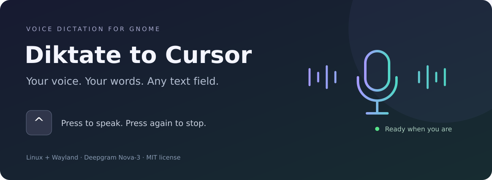
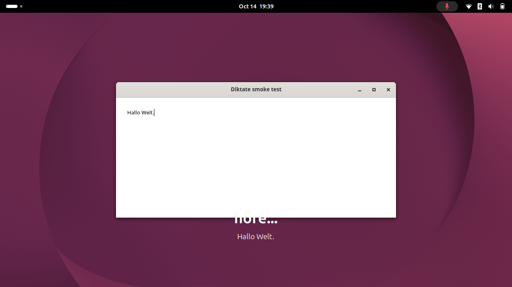

<p align="center"></p>

<p align="center">
  <a href="LICENSE"></a>
  <a href="https://github.com/Sportinger/diktate-to-cursor/actions/workflows/tests.yml"></a>
  
  
</p>

# Diktate to Cursor

**Press a key. Speak. Keep working.** Live voice dictation for the text field you're using, with a small microphone in the GNOME panel and a listening overlay that stays out of the way.

“Cursor” means your text cursor: this is a desktop tool, not a plugin limited to the Cursor editor. It works by pasting recognized speech into the focused application, including supported terminals.

[Install](#install) · [Controls](#controls) · [Privacy](#privacy-and-cloud-transcription) · [Deutsche Anleitung](README.de.md)

## What it does

- **Live dictation:** confirmed words are inserted as you speak; interim words appear in an overlay.
- **One-key toggle:** press `^` to start and press it again to stop. Holding the key does not toggle repeatedly.
- **Finish and submit:** press Enter during a recording, or say **“go go”**. Remaining words are pasted before one Enter key is sent.
- **Spoken slash commands:** “slash model” becomes `/model`; “slash zoom” becomes `/zoom`.
- **Ready feedback:** the overlay starts with `starte...`, briefly flashes green when the microphone is ready, then shows `höre...`.
- **Pause feedback:** a growing red warning after a long pause; automatic stop after 30 seconds without recognized speech.
- **Connection fallback:** switches from streaming to short audio chunks when necessary, without retranscribing confirmed text.
- **Screenshot shortcut:** `Shift` + `Alt` + `S` freezes the desktop for region selection and copies the crop as a PNG.
- **Autostart and settings:** microphone, language, model, and transfer mode are available from the panel menu.

The interface is currently in German. Dictation supports German, English, and automatic multilingual recognition. German is the default.



*Actual GNOME 50 integration-test session with simulated speech results. No personal desktop or microphone audio is shown.*

## Install

**Tested:** Ubuntu 26.04, GNOME 50.1, Wayland. The extension declares GNOME 45–50; older versions have not received the same integration coverage. Other desktops, Windows, and macOS are not implemented.

You need Python 3.11+, GNOME, GTK 4/Libadwaita, FFmpeg with PulseAudio support, and your own **Deepgram API key**. PipeWire works through its PulseAudio compatibility layer.

```bash
sudo apt install git python3-venv python3-gi \
  gir1.2-gtk-4.0 gir1.2-adw-1 ffmpeg
mkdir -p ~/Documents
git clone https://github.com/Sportinger/diktate-to-cursor.git ~/Documents/diktate-to-cursor
cd ~/Documents/diktate-to-cursor
./install.sh
```

Run the installer as your regular user, without sudo. It creates a Python environment, installs the GNOME extension and user service, and enables autostart. Keep the checkout in place; the service uses its virtual environment.

**Log out and back in after the first installation.** GNOME needs to load the new extension. Open **microphone → Einstellungen** and enter your Deepgram key. If `DEEPGRAM_API_KEY` was already present when installing, it is saved to the private configuration automatically.

## Controls

| Action | Control |
| --- | --- |
| Start or stop dictation | `^` or the microphone menu |
| Stop, finish pasting, and submit | Enter / keypad Enter during recording, or say “go go” |
| Type a slash command | Say “slash” followed by its name |
| Copy the last full dictation | **Letztes Diktat kopieren** in the menu |
| Select a screenshot region | `Shift` + `Alt` + `S` |
| Cancel screenshot selection | Escape |
| Change dictation language | **Sprache** in the microphone menu |
| Configure microphone or API key | **Einstellungen** |

`^` is reserved while the extension is enabled. The default binding is designed for a German keyboard; if your layout does not produce a caret or dead circumflex directly, customize the `diktate-toggle-recording` GSettings binding in the extension schema.

Pressing `^` to stop never submits the text. Enter is intercepted only during recording and only while the window where you started dictating has focus; submission happens only after the final words are inserted. Shift+Enter, Enter in other windows, and normal Enter outside recording retain their usual behavior. Recording errors do not automatically submit.

Text stays with the window that had focus when you pressed `^`. If you click into another window to look something up, finished sentences wait instead of landing there, and the overlay shows **wartet auf ‹App›**. When you return to that window, the waiting text is pasted in order, followed by a pending Enter. Meanwhile the clipboard holds the full dictation so far as a backup, unless you copied something else in the meantime. A dictation that is still waiting after you stop turns the microphone icon light blue. If the start window is closed, nothing is pasted elsewhere: the text stays on the clipboard and a notification says so. Within the start window, switching text fields still moves later text there. If no window had focus at the start, text follows the current focus.

The tool pauses pasting while modifiers, menus, or the overview interfere. Ordinary applications receive Ctrl+V; recognized terminals receive Ctrl+Shift+V. Editor-embedded terminals and applications with custom paste shortcuts may need adjustments.

### Optional: Raster terminal

If dictation starts in a Raster window (a tiling terminal for Claude Code and Codex sessions) and the `raster` command is installed (on `PATH` or in `~/.local/bin`), the extension asks Raster which tile has keyboard focus and types the text straight into that tile with `raster type`, without changing focus. You can keep working in another app or tile while the text arrives in the original tile; a spoken or physical Enter also goes to that tile. Enter pressed in a different tile of the Raster window stays an ordinary Enter for that tile. If Raster cannot be reached, dictation falls back to the window behavior above. Nothing changes when Raster is not installed. `DIKTATE_RASTER_BIN` in the GNOME Shell environment overrides the command path.

## Screenshots

Region selection uses the desktop image captured when the shortcut is pressed, so a playing video stays frozen in the preview and saved crop. Screenshots are copied to the clipboard and saved under your Pictures folder in `Screenshots`.

Choose **Screenshot-Qualität** for full-resolution lossless PNG or a compact version with a maximum dimension of 1920 pixels. **Screenshot: ganzer Bildschirm** captures the monitor under the pointer. For terminals that cannot paste images, use **Letzten Screenshot-Pfad kopieren** to copy a shell-quoted file path.

## Privacy and cloud transcription

**Speech recognition is a cloud service.** During an active recording, microphone audio is sent to Deepgram using your account and may incur its normal usage charges. This is not an offline speech engine. See [Deepgram's documentation](https://developers.deepgram.com/docs/overview) for service details.

The microphone opens only when you start recording. Audio is buffered in memory; the application does not save audio files or a transcript history. The final dictation remains available in the clipboard and the running app's “copy last dictation” action. Recording ends on screen lock, extension deactivation, 30 seconds without recognized speech, or the 30-minute session limit.

The key is stored in `~/.config/diktate-to-cursor/config.json` with `0600` permissions. It is not placed in the repository or service unit. Logs contain timing and status, not the audio or recognized words. Screenshots are local files and are not sent to Deepgram.

## Troubleshooting and updates

```bash
./run.sh             # Start service and enable the extension
./run.sh status      # Recording state; does not start recording
./run.sh stop        # Stop an active recording
systemctl --user status diktate-to-cursor.service
journalctl --user -u diktate-to-cursor.service -n 40
gnome-extensions info diktate-to-cursor@local
```

If the microphone icon is missing, log out and in and check that the extension is enabled. For input problems, verify the GNOME default input or choose a source listed by `ffmpeg -sources pulse`.

`./run.sh doctor` checks streaming and REST with **synthetic silence**, without opening your microphone. It contacts Deepgram and can use billable API quota; it is not an offline test.

To update a clean checkout:

```bash
git pull --ff-only
./install.sh
systemctl --user restart diktate-to-cursor.service
```

Log out and in when the extension itself has changed; restarting the Python service does not reload GNOME's JavaScript.

To uninstall while retaining your personal configuration:

```bash
.venv/bin/python -m diktate uninstall
```

## Development

The Python service handles recording, transcription, fallback, and state. The GNOME extension handles the hotkey, overlay, clipboard, screenshot selection, and virtual keyboard. They communicate over the session D-Bus `io.github.diktate.Cursor`.

```bash
.venv/bin/python -m unittest discover -s tests -v
node --check gnome-extension/extension.js
node --check gnome-extension/prefs.js
node --check gnome-extension/screenshot.js
node --check gnome-extension/delivery.js
node --check gnome-extension/raster.js
bash tests/gnome_smoke.sh  # Isolated GNOME 50 Wayland session, mocked service
```

The integration test uses a separate desktop and synthetic text. It tests hotkeys, overlay states, paste-before-Enter ordering, text waiting for its start window, Enter outside the start window, a closed start window, the Raster tile path against a stand-in `raster` command (`tests/fake_raster.py`), screenshots, and cleanup. It does not use your microphone or a Deepgram key. See [CONTRIBUTING.md](CONTRIBUTING.md) for details.

## License

[MIT](LICENSE) · Copyright © 2026 Sportinger.

An independent project, not affiliated with Deepgram, GNOME, or the Cursor editor. Their names identify integrations and compatibility.
